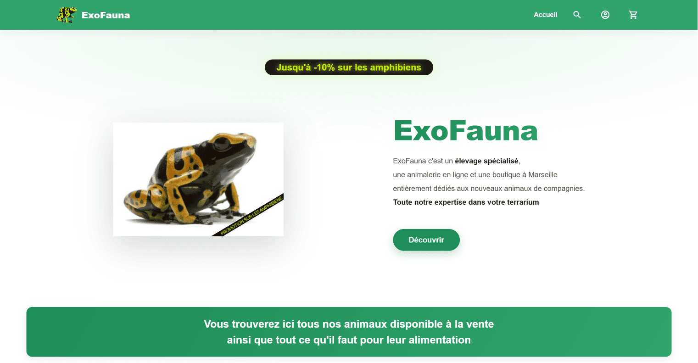
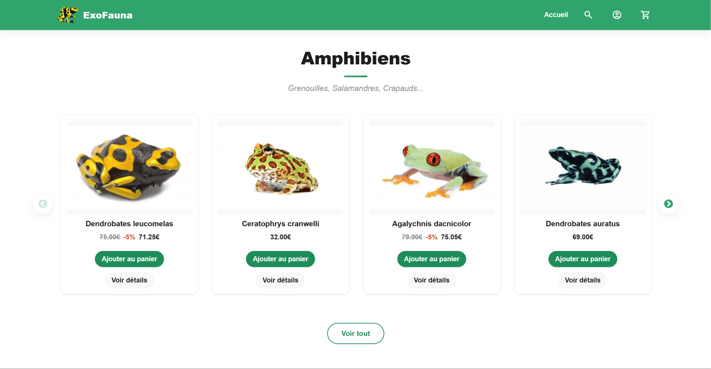
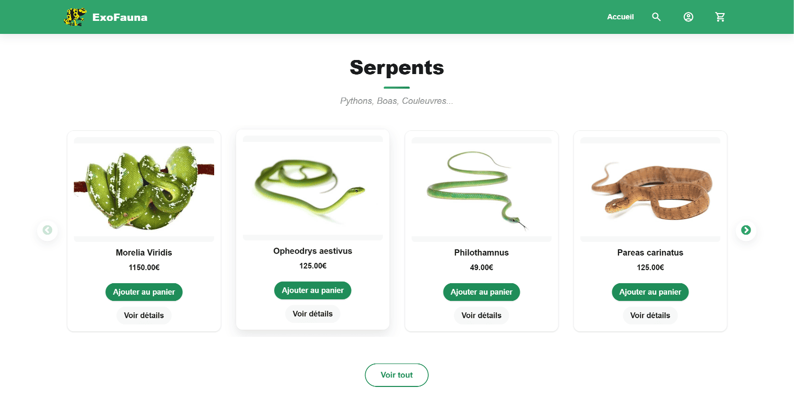
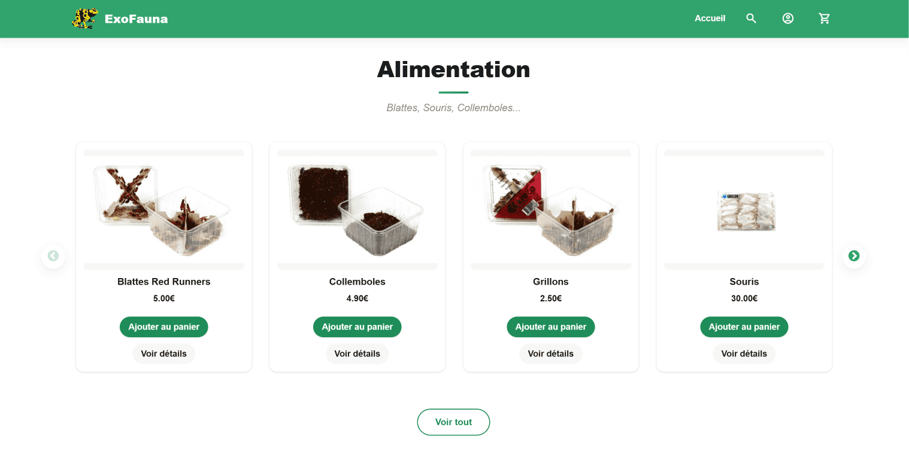
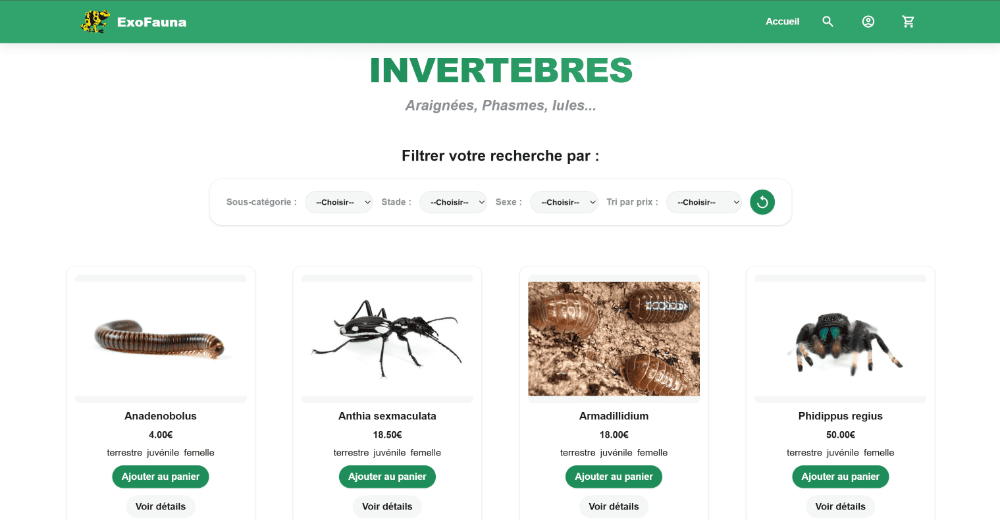
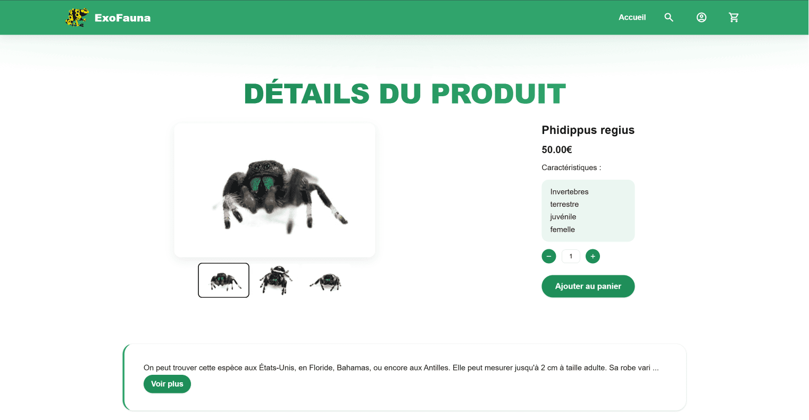
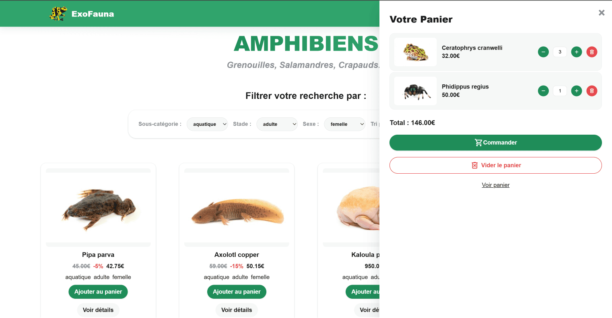

# ExoFauna

ExoFauna est un projet développé dans le cadre d'un cours visant à pratiquer les compétences en développement web telles que JavaScript, HTML et SCSS. L'objectif était de créer une petite boutique en ligne avec quelques fonctionnalités spécifiées dans un cahier des charges.

## Fonctionnalités

- **Boutique en ligne :** Le projet propose une interface utilisateur pour parcourir et acheter des produits de la boutique.

- **Gestion du panier :** Les utilisateurs peuvent ajouter des produits à leur panier et procéder à la commande pour finaliser leur achat.

- **Pages produit détaillées :** Chaque produit dispose d'une page détaillée avec des informations telles que la description, le prix, les options disponibles, etc.

- **Pages catégories avec fonctionnalités de tri :** Le projet inclut des pages de catégories avec des fonctionnalités de tri pour faciliter la recherche des utilisateurs.

- **Différents types de carrousels avec Slick :** Le projet utilise le plugin Slick pour mettre en place différents types de carrousels, offrant ainsi une expérience utilisateur interactive.

## Technologies utilisées

- **JavaScript :** Utilisé pour la logique côté client, y compris la gestion du panier, l'interaction avec les produits, etc.

- **HTML :** Langage de balisage utilisé pour structurer le contenu des pages web.

- **SCSS :** Utilisé pour styliser les éléments de l'interface utilisateur et appliquer des feuilles de style.

## Structure du projet

```
exoFauna/
├── index.html              # Page d'accueil
├── style.css               # CSS compilé depuis le SCSS (ne pas éditer à la main)
├── templates/              # Autres pages (catégorie, détails, panier, livraison, remerciement)
├── assets/
│   ├── js/                 # Scripts (logique, panier, filtres, carrousels)
│   │   └── bdd.json        # « Base de données » des produits (chargée via fetch)
│   ├── scss/               # Sources de style ; point d'entrée : index.scss
│   ├── fonts/
│   └── images/
└── README.md
```

## Prérequis

- Un navigateur web moderne.
- [Node.js](https://nodejs.org/) (uniquement pour lancer un serveur local et/ou compiler le SCSS).

> ℹ️ Les bibliothèques tierces (jQuery, [Slick](https://kenwheeler.github.io/slick/), Boxicons, Material Symbols) sont chargées via CDN : aucune installation de dépendances n'est nécessaire, mais une connexion Internet est requise au premier lancement.

## Lancer le projet

Les pages chargent les données via `fetch("./assets/js/bdd.json")`. Ouvrir directement `index.html` (protocole `file://`) **ne fonctionne pas** : le navigateur bloque la requête. Il faut servir le projet via un serveur HTTP local.

**Option 1 — VS Code + Live Server (recommandé)**

1. Installer l'extension [Live Server](https://marketplace.visualstudio.com/items?itemName=ritwickdey.LiveServer).
2. Faire un clic droit sur `index.html` → **Open with Live Server**.

**Option 2 — En ligne de commande**

```bash
# avec Node.js
npx serve .

# ou avec Python 3
python -m http.server 8000
```

Puis ouvrir l'URL affichée (ex. `http://localhost:8000`).

## Modifier les styles (SCSS)

Le fichier `style.css` est généré à partir de `assets/scss/index.scss` ; il ne faut pas le modifier directement. Pour recompiler à chaque changement :

**Option 1 — VS Code**

Installer l'extension [Live Sass Compiler](https://marketplace.visualstudio.com/items?itemName=glenn2223.live-sass) puis cliquer sur **Watch Sass**. Veiller à ce que la sortie soit configurée vers `style.css` à la racine.

**Option 2 — En ligne de commande**

```bash
npx sass --watch assets/scss/index.scss style.css
```

## Remarque

Ce projet est principalement destiné à des fins pédagogiques et de démonstration. Il ne comprend pas de fonctionnalités complètes de commerce électronique ou de paiement en ligne réel.

## Petit aperçu 👀

<br>